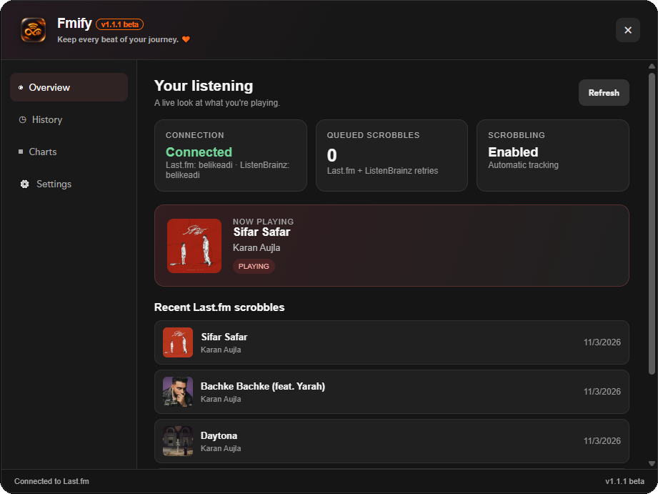
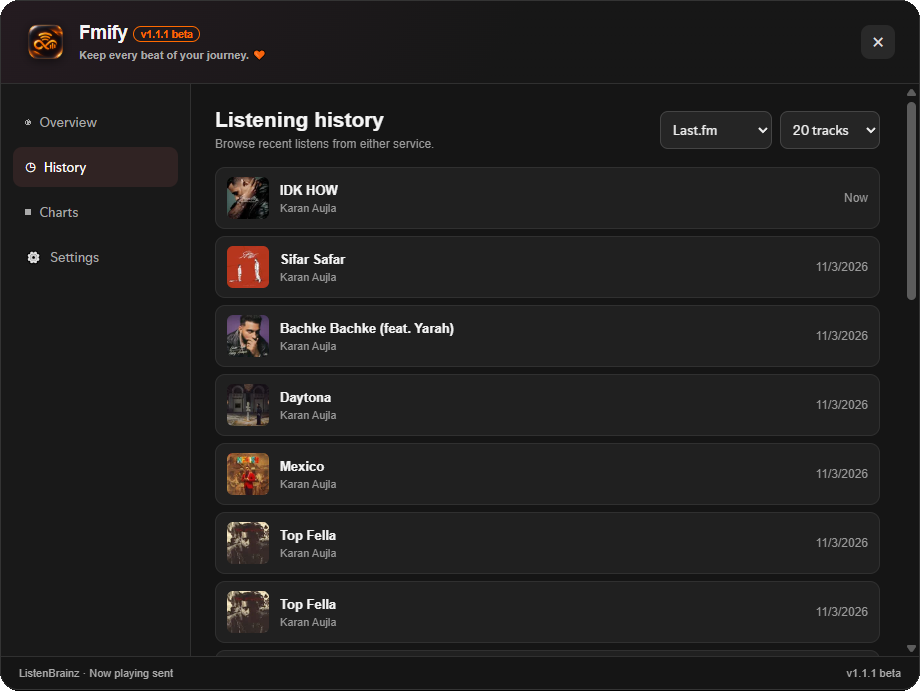
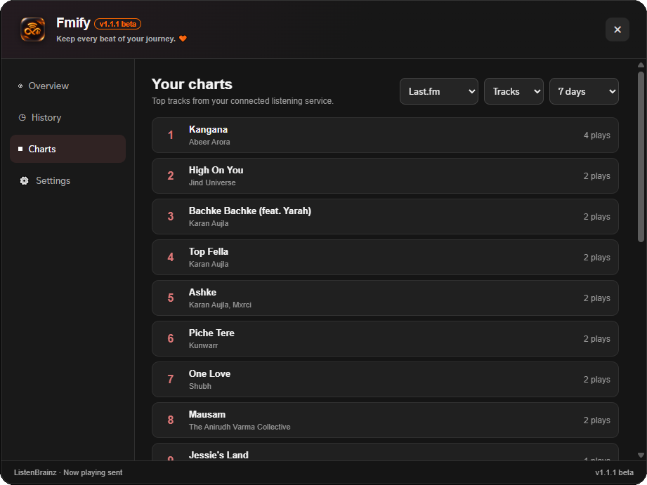
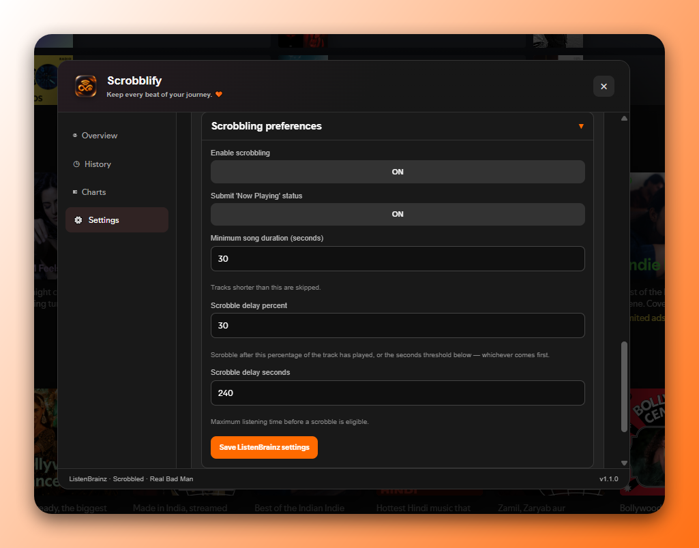
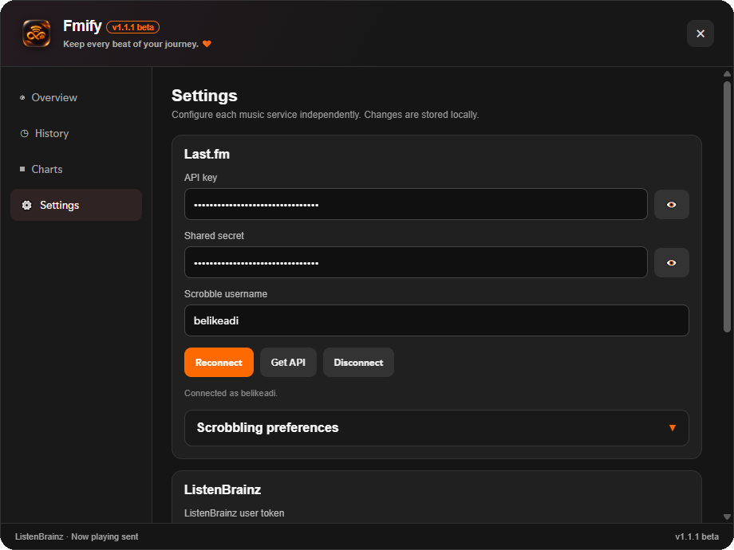
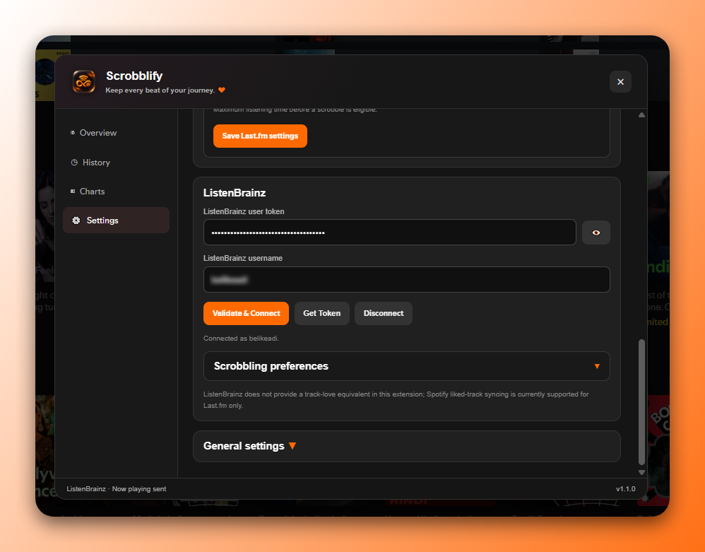

<div align="center">

  

  # Fmify

  **Keep every beat of your journey. 🧡**

  A local-first Spotify scrobbler for Spicetify.

  [Features](#-features) · [Installation](#-installation) · [Setup](#-connect-your-services) · [Privacy](#-privacy)

  
  
  
  

</div>


---

> 📛 **Name change:** This project was previously called Scrobblify. It's now Fmify, with the same features and settings.
---
## 🧪 Beta Notice

Fmify  is an early public beta. Bugs, unexpected behaviour, and compatibility issues may occur. Please report problems in [Issues](https://github.com/adityq/fmify/issues).

## 🎵 What is Fmify?

Fmify is a **Spicetify extension for Spotify desktop on Windows** that sends your listening activity to **Last.fm** and **ListenBrainz** independently.

Connect either service or both. Each has its own credentials, controls, connection status, and retry queue. Your listening data is sent directly from Spotify to the services, with no Fmify server in the middle.

## ✨ Features

| | Feature | What it does |
|:--:|---|---|
| ↗️ | **Dual scrobbling** | Send listening activity to Last.fm and ListenBrainz independently |
| 🎶 | **Now Playing** | Update both services when your track changes |
| 🕘 | **Listening history** | Browse recent listening activity |
| 📊 | **Charts & stats** | Explore top tracks, artists, albums, recordings, and releases |
| ❤️ | **Spotify like sync** | Liking a track in Spotify loves it on Last.fm, and unliking removes the love. On by default; can be turned off in Settings |
| 🔄 | **Offline retry** | Queue submissions for retry, with per-service duplicate protection |
| ⚙️ | **Independent controls** | Configure each service separately from the dashboard |

## 🖥️ Dashboard

- **🏠 Overview**: Playback and connection status.
- **📜 History**: Recent listening activity from either service.
- **📈 Charts**: Listening statistics and top items.
- **⚙️ Settings**: Credentials, service switches, and scrobbling preferences.

## 📸 Screenshots

<details>
  <summary><strong>👁️ Preview Screenshots</strong></summary>

  <h3>🏠 Main Interface</h3>
  <p align="center">
    
  </p>

  <h3>🎵 Overview Dashboard</h3>
  <p align="center">
    
  </p>

  <h3>📜 Listening History</h3>
  <p align="center">
    
  </p>

  <h3>📊 Charts & Statistics</h3>
  <p align="center">
    
  </p>

  <h3>⚙️ Settings</h3>
  <p align="center">
    
  </p>

  <h3>🌐 Last.fm Connection</h3>
  <p align="center">
    
  </p>

  <h3>🎧 ListenBrainz Connection</h3>
  <p align="center">
    
  </p>

</details>

## 📋 Requirements

- Spotify desktop for Windows
- [Spicetify CLI](https://spicetify.app/) installed and applied
- A [Last.fm](https://www.last.fm/) account and API credentials (optional)
- A [ListenBrainz](https://listenbrainz.org/) account and user token (optional)

## 🚀 Installation

1. Close Spotify.
2. If you installed an older version, remove it first:

   ```powershell
   spicetify config extensions scrobblify.js-
   ```

3. Copy `fmify.js` into `%appdata%\Spicetify\Extensions\`. Replace the old file if it's still there.
4. Run:

   ```powershell
   spicetify config extensions fmify.js
   spicetify apply
   ```

5. Restart Spotify and click the Fmify music-note button.
6. Open **Settings** and connect your preferred service.

## 🔗 Connect your services

<details>
<summary>🎧 <strong>Last.fm</strong></summary>

1. Create API credentials at https://www.last.fm/api/account.
2. Enter your API key, shared secret, and username in Fmify Settings.
3. Click **Save & Connect** and approve the app.
4. Return to Spotify and click **I've approved — finish connection**.

</details>

<details>
<summary>🎵 <strong>ListenBrainz</strong></summary>

1. Open https://listenbrainz.org/settings/ and copy your user token.
2. Paste it into Fmify Settings.
3. Click **Validate & Connect**.

</details>

## 🔒 Privacy

- Credentials, preferences, duplicate guards, and retry queues are stored in Spicetify local storage for the current Windows user.
- Requests go directly from Spotify to Last.fm and ListenBrainz.
- No companion server, analytics endpoint, telemetry, or third-party proxy is used.
- Spicetify local storage is not a secure secret vault. Tokens and secrets are accessible to software running as your Windows user.
- Disconnect clears locally stored credentials. Revoke app access separately in each service's settings if needed.

## 📝 Notes & limitations

Fmify focuses on music tracking and personal listening features. It does not reproduce every feature of the Last.fm or ListenBrainz websites or APIs.

Spotify like sync currently works with Last.fm only. ListenBrainz love and hate feedback requires a recording identifier, so it may be unavailable if the service doesn't return one.

The extension has been syntax-checked and tested on a few setups, but has not yet been fully exercised across all Spotify installations or account configurations.

<details>
<summary>🛠️ <strong>Troubleshooting</strong></summary>

- **Button missing:** Confirm the extension is installed and run `spicetify apply`.
- **Last.fm authorization error:** Verify your API key and shared secret.
- **ListenBrainz token error:** Generate a new token in ListenBrainz Settings.
- **Scrobbles not sending:** Check the scrobbling switches and connection status. Inspect Spotify DevTools (`Ctrl` + `Shift` + `I`) for errors.
- **Like sync not working:** Make sure "Love Spotify-liked tracks on Last.fm" is on in Settings.

</details>

## 📄 License

[MIT](LICENSE)

---

<div align="center">

  <p><strong>✨ A little about Fmify 🤖 ✨</strong></p>

  Fmify is a **vibe-coded project**, built with human ideas, AI assistance, experimentation, debugging, and plenty of trial and error.

  An independent project driven by curiosity and a love for music.

  <br>

  ---

  **Made by a fellow Indian, for music lovers everywhere. 🇮🇳🎧**

</div>
